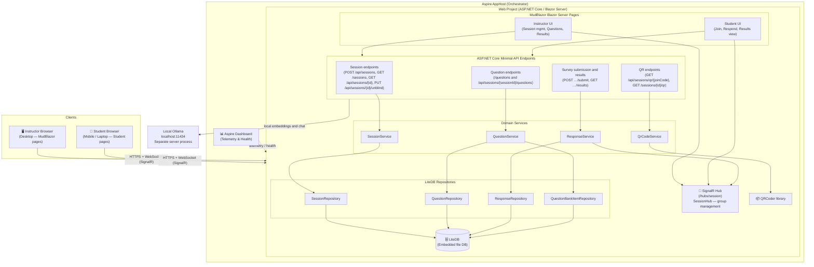
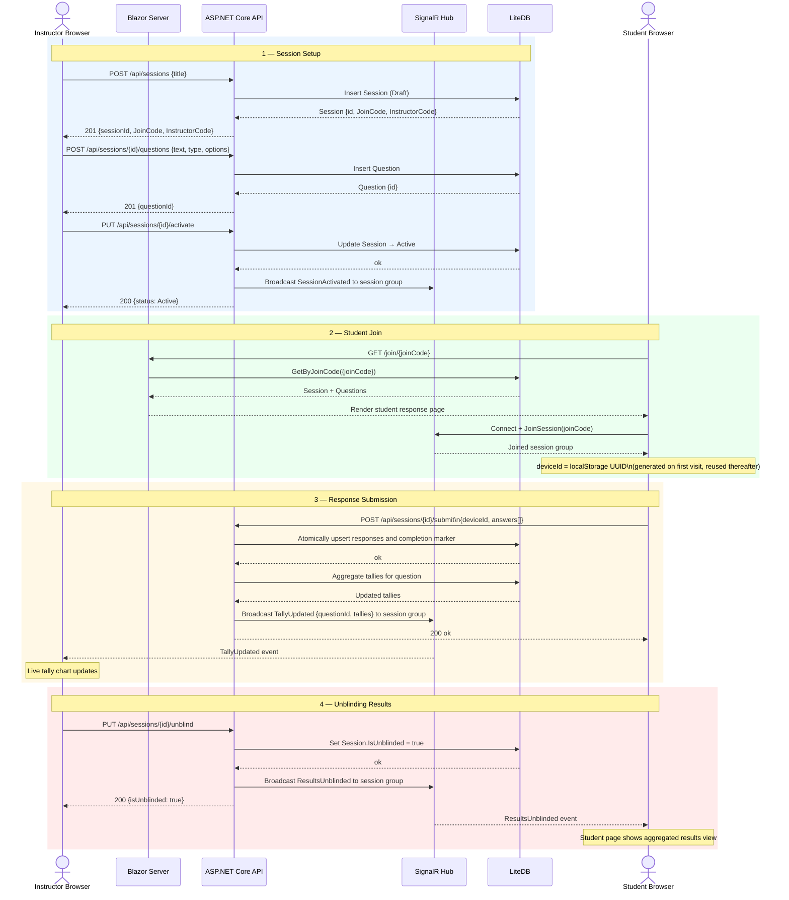

# Pulse — Architecture

---

## Solution Architecture

### Optional development tunnel topology

The current AppHost runs separate WebApi, WebApp, Admin, MigrationManager, and
Scalar resources. For remote-device testing, `DevTunnels:Enabled` adds one named
persistent anonymous tunnel per HTTP application (WebApi, WebApp, Admin, Scalar).
The dashboard, telemetry, management endpoints, and MigrationManager stay private.
This mode is for Development only and is disabled by default.

AppHost provisions and checks tunnel definitions through the devtunnel CLI,
preserves fixed forwarding ports, reads service-reported HTTPS addresses, reuses
verified running hosts, and owns only the processes it starts. Public readiness
is checked against a per-launch application marker and configured HTTPS origin.
Persistent definitions survive shutdown; prolonged public outages fail the run.

API clients use the API tunnel. Both QR handlers encode the WebApp tunnel's
`/join/<code>` URL, and the component displays the same configured join origin.
Scalar reaches the public API directly for OpenAPI documents and requests.
Development tunnel mode enables CORS only for the configured Scalar tunnel
origin, with no credentialed CORS. Its built-in 0.8.63 proxy is disabled in this
mode because forwarding the incoming Scalar Host header misroutes cross-tunnel
requests. Aspire health checks and forwarding transport still use local
endpoints. Public TLS terminates at the tunnel; the applications normalize
scheme/host only for the configured public host arriving through a loopback
proxy, retaining antiforgery and application authorization.

See [setup/lifecycle](onboarding.md#7-persistent-anonymous-dev-tunnels) and
[troubleshooting](troubleshooting.md#persistent-dev-tunnel-issues).

The diagrams below describe the broader conceptual architecture and workflows.

This diagram shows the full deployment topology of Pulse: how the Aspire AppHost orchestrates the Web server and Foundry Local, what lives inside the Web process, and how instructor and student browsers interact with it.
This diagram shows the Pulse deployment topology. The repository has separate WebApp, Admin, WebApi, and Aspire projects. Instructor session, question, QR, and live-results workflows live in Admin, while anonymous survey participation and revealed aggregate results live in WebApp. SignalR distributes live progress, closure, and reveal events without breaking existing join links.



---

## Route compatibility

The application split must preserve existing links while establishing clear ownership:

- `Pulse.WebApp` owns the canonical student route `/join/{joinCode}`.
- Existing `/quiz/{joinCode}` links redirect to `/join/{joinCode}` during the transition.
- Existing `/instructor` and `/instructor/*` WebApp routes redirect to their `Pulse.Admin` equivalents after those pages move.
- QR codes use the configured public WebApp base URL when present. Without it,
  the API falls back to the incoming QR request origin, which is suitable for
  same-host use but must not be used for cross-device testing unless that
  origin is publicly reachable.
- Redirects remain until usage data and release notes support their removal.

For local mobile testing, AppHost normally orchestrates a persistent anonymous
`pulse-devtunnel` exposing the API and student HTTPS endpoints. The public
student endpoint reference is injected as `App__JoinBaseUrl` (API QR encoding)
and `StudentApp__BaseUrl` (Admin displayed link) before consumers start.
Admin is never tunneled; internal service calls retain local service discovery.
The tunnel identity survives host shutdown, while hosting lasts only for the
AppHost session. This is run-mode-only infrastructure, not a deployment.

Alternatively, the manual launcher hosts a configured named tunnel, reads
its published port 7004 `portUri`, and supplies that value to AppHost as
`Pulse:PublicJoinBaseUrl` (environment form:
`Pulse__PublicJoinBaseUrl`). AppHost accepts only an absolute HTTPS URL and
forwards it to the API as `App__JoinBaseUrl` and Admin as
`StudentApp__BaseUrl`. The public tunnel terminates HTTPS and forwards port
7004, including WebSocket traffic, to the student Blazor Server app. API and
Admin endpoints are not directly exposed by the manual workflow. An explicit
`Pulse:PublicJoinBaseUrl` disables the Aspire-managed tunnel.

Telemetry records session/question correlation, counts, status, request method,
path, exception type, a message-free stack trace, and correlation ID. Student
answer values and persistent device IDs are deliberately excluded. Unhandled
exceptions are logged by type and sanitized stack trace without attaching the
exception object because exception messages can contain repository input.

## Persistence compatibility

LiteDB session documents retain their existing stored field names while application code uses typed concepts:

- Existing string `Status` values map to `SessionStatus`; unknown or missing values safely default to `Draft`.
- A missing `Mode` defaults to `Survey`, so existing sessions are never interpreted as trivia.
- Existing `IsUnblinded` values map to typed `ResultsVisibility`.
- Draft-to-Active and Active-to-Closed are the only valid lifecycle transitions.
- Future schema changes must include repository tests that read representative legacy documents.

## Target Activity Flow

This sequence diagram describes the implemented classroom survey workflow, including lifecycle endpoints, atomic whole-survey submission, SignalR events, polling fallback, and instructor-controlled student result reveal.

Trivia uses its own game, team, participant, question, and answer collections.
Approved bank questions are copied into a game so later bank edits cannot
change an active competition. The API timestamps question opening and answer
receipt, calculates points, and returns player-safe state without correct
answers. Individual and team leaderboards are derived from persisted awarded
points and refreshed by the Blazor clients.



---

## Local document-grounded question generation

Ollama runs independently on the API host with OpenAI-compatible base URL
`http://localhost:11434/v1`. AppHost passes this configuration to the API;
Ollama is not part of dev tunnel provisioning or public readiness checks.
`gemma4:latest` generates structured multiple-choice questions and
`all-minilm:latest` embeds grounding passages. No new Aspire resource or cloud
service is required. The feature is grouped under
`src/Pulse.WebApi/Features/SurveyGeneration` and reuses existing survey
ownership, draft lifecycle, question persistence, and instructor UI.

Original documents and extracted text are stored with a grounding revision in
LiteDB. Generation embeds overlapping chunks, ranks them by cosine similarity,
and selects at most 12 passages, reserving coverage for every document.
The model returns a `passageId` referencing one of those selected chunks, not a
model-written quote. The server validates the ID and populates the existing
`SourceId` and `SourceQuote` fields from the original chunk ID and text.
Question count, choices, and answer keys remain validated. Citation text is
verbatim by construction; instructors still review whether it supports the answer.
Previews are server-stored and expire after one hour; approval is transactional.
Student APIs project questions without answer keys, explanations, or citations.

```mermaid
sequenceDiagram
    actor IB as Instructor Browser
    participant API as ASP.NET Core API
    participant AiSvc as OllamaSurveyGenerator
    participant OL as Local Ollama
    participant DB as LiteDB

    rect rgb(245, 235, 255)
        IB->>API: Upload documents and save additional context
        API->>DB: Persist original documents, extracted text, revision
        IB->>API: POST /api/sessions/{id}/questions/generate\n{count}
        API->>AiSvc: GenerateAsync(material, title, count)
        AiSvc->>OL: POST /v1/embeddings (chunks and query)
        OL-->>AiSvc: Local embeddings
        Note over AiSvc: Retrieve relevant passages
        AiSvc->>OL: POST /v1/chat/completions (gemma4:latest, JSON schema)
        OL-->>AiSvc: Questions, choices, answer keys, passage IDs
        Note over AiSvc: Validate questions and passage IDs; copy original citations
        AiSvc-->>API: Validated questions
        API->>DB: Store preview with grounding revision
        API-->>IB: 200 preview ID and questions

        Note over IB: Instructor reviews and approves or discards batch

        IB->>API: POST /api/sessions/{id}/questions/generated/{previewId}/accept
        API->>DB: Verify revision, append questions, consume preview
        DB-->>API: ok
        API-->>IB: 200 questions persisted
    end
```
