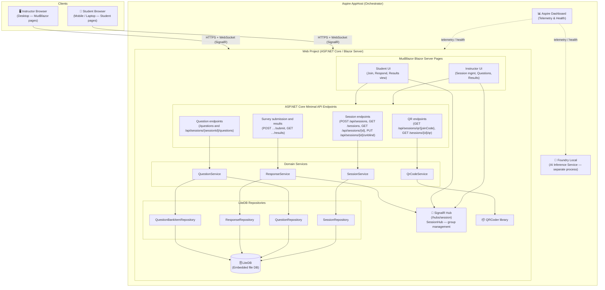
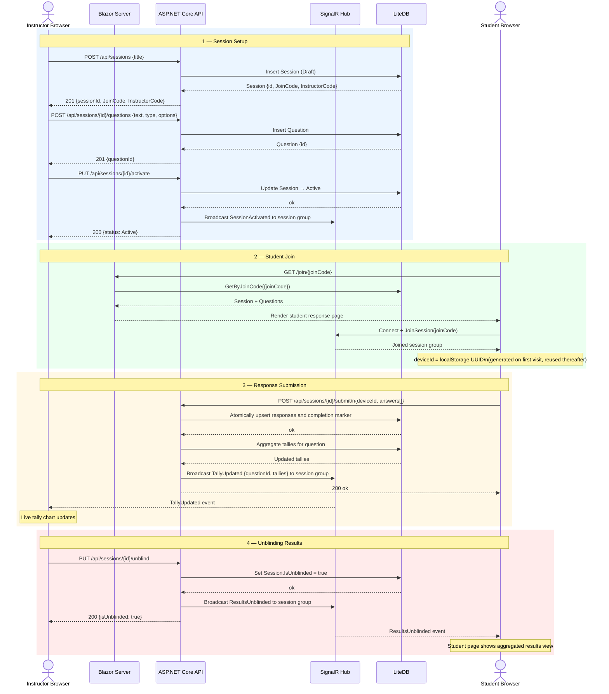
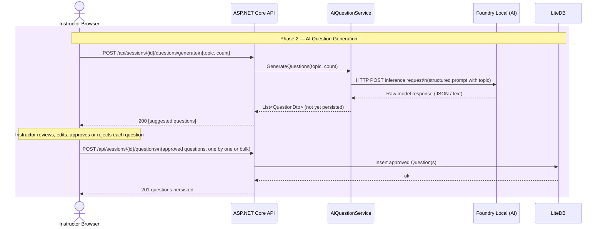

# Pulse — Architecture

---

## Solution Architecture

This diagram is the target deployment topology for Pulse. The repository has separate WebApp, Admin, WebApi, and Aspire projects, and instructor session/question/QR workflows now live in Admin with compatibility redirects from their former WebApp routes. SignalR is not implemented yet; the approved redesign will add the dashed/planned real-time behavior without breaking existing join links.

---

## Route compatibility

The application split must preserve existing links while establishing clear ownership:

- `Pulse.WebApp` owns the canonical student route `/join/{joinCode}`.
- Existing `/quiz/{joinCode}` links redirect to `/join/{joinCode}` during the transition.
- Existing `/instructor` and `/instructor/*` WebApp routes redirect to their `Pulse.Admin` equivalents after those pages move.
- QR codes always use the configured public WebApp base URL, never the API or Admin URL.
- Redirects remain until usage data and release notes support their removal.

## Persistence compatibility

LiteDB session documents retain their existing stored field names while application code uses typed concepts:

- Existing string `Status` values map to `SessionStatus`; unknown or missing values safely default to `Draft`.
- A missing `Mode` defaults to `Survey`, so existing sessions are never interpreted as trivia.
- Existing `IsUnblinded` values map to typed `ResultsVisibility`.
- Draft-to-Active and Active-to-Closed are the only valid lifecycle transitions.
- Future schema changes must include repository tests that read representative legacy documents.

## Target Activity Flow

This sequence diagram describes the approved target classroom workflow, not the current implementation. In particular, activation/closure endpoints, SignalR events, atomic whole-survey submission, and student-side result reveal still need to be implemented.

---

## Deferred AI Question Generation

This sequence captures an earlier AI-assisted question-generation concept. It is deferred behind the approved survey redesign, moderated question bank, and trivia phases; Foundry Local is not currently registered in the AppHost.

